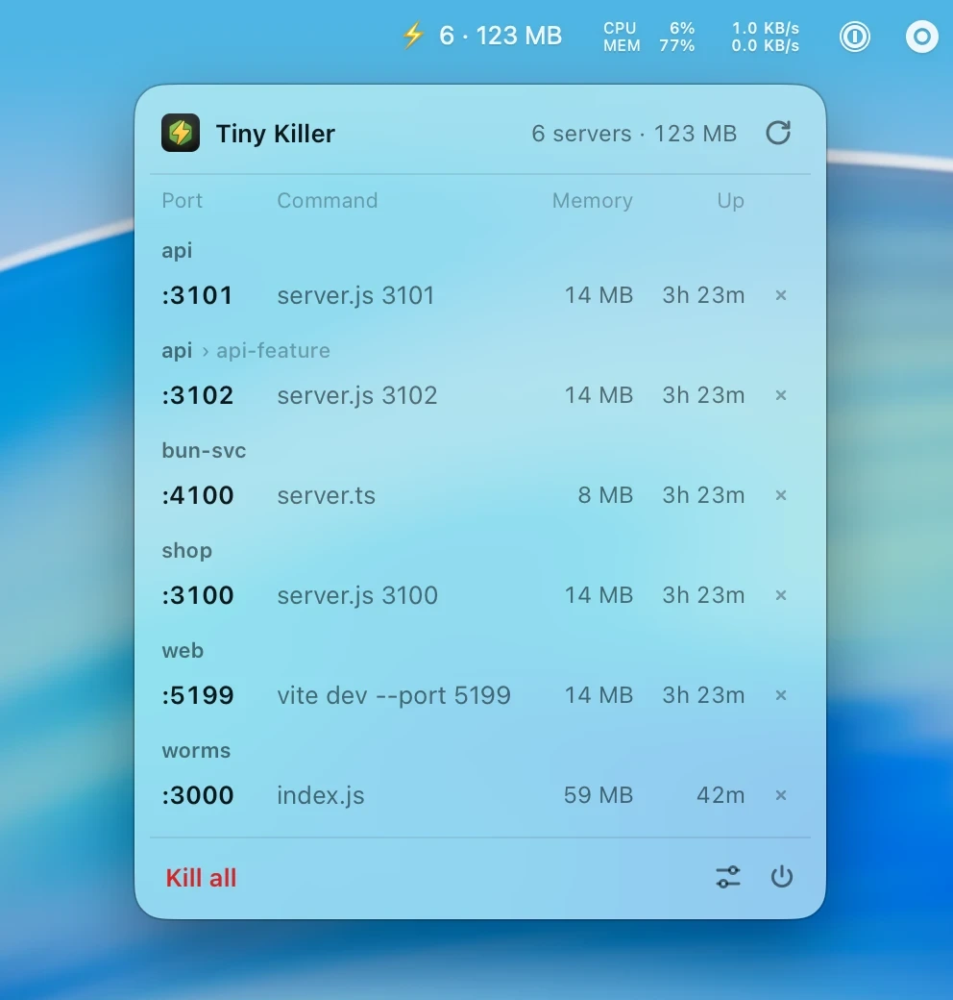
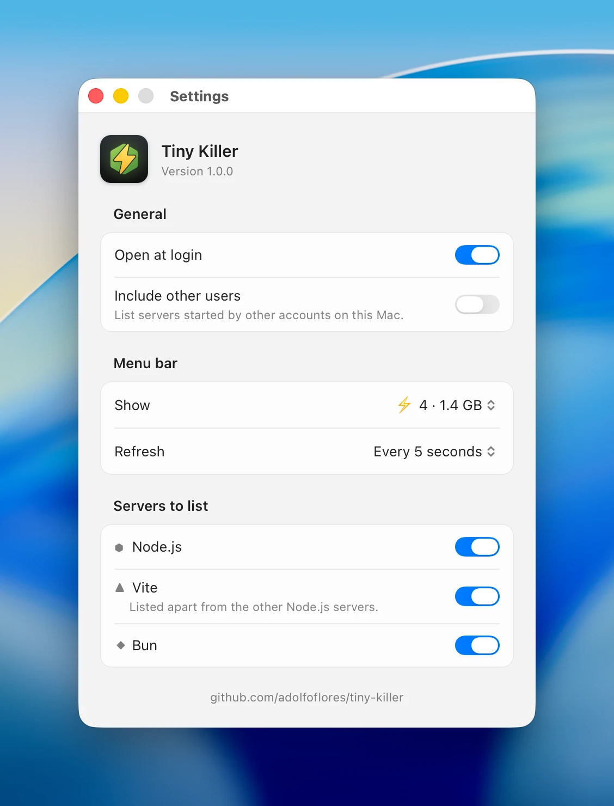

# ⚡️ Tiny Killer

[](https://tinyjs.app)
[](https://developer.apple.com/macos/)
[](./LICENSE)

⚡️ **Tiny Killer** es la versión tiny de [Node Killer](https://github.com/adolfoflores/node-killer). Vive en la barra de menús de tu Mac, te muestra los servidores de desarrollo de **Node.js**, **Vite** y **Bun** que tienes en marcha y detiene cualquiera de ellos con un clic.

🇬🇧 [Read in English](./README.md)

<p align="center">
  
  &nbsp;
  
</p>

## 🪶 Por qué tiny

Node Killer está hecho con Electron, que mete un navegador web entero dentro de la app. Tiny Killer está hecho con [tinyjs](https://tinyjs.app) y usa lo que macOS ya trae, así que la misma app ocupa una fracción del espacio.

| | Tiny Killer | Node Killer |
| --- | --- | --- |
| Tamaño de la app | **16 MB** (Intel + Apple Silicon) | 257 MB (solo Apple Silicon) |

## ✨ Funciones
- 📊 **Contador en vivo** en la barra de menús de los servidores en marcha, si quieres con su memoria o CPU total (`⚡️ 4 · 1.4 GB`).
- 🪟 **Panel**: haz clic en el icono para ver tus servidores agrupados por proyecto, con su puerto, memoria y cuánto llevan en marcha. Pasa el ratón por uno para ver más detalle, y detenlo con un clic.
- 🖱️ **Menú clásico**: con clic derecho en el icono, la misma lista como un menú normal de macOS.
- 🔪 **Lo detiene bien**: el servidor se va junto con la herramienta que lo lanzó (`npm run dev`, `next dev`, …), igual que al pulsar Ctrl-C. Si no se deja detener, el panel te dice por qué.
- 💣 **Kill all**, tras una confirmación rápida.
- 🧰 **Ajustes** con el aspecto de macOS: abrir al iniciar sesión, qué muestra la barra de menús, cada cuánto refrescar y qué tipos de servidor listar.
- 🔄 **Se mantiene al día**: busca una versión nueva una vez al día, y con un clic la instala.
- 📦 **¿Vienes de Node Killer?** Tiny Killer se trae tus ajustes la primera vez que se abre.

## 📥 Descarga

Descarga el `.dmg` desde la [última versión](https://github.com/adolfoflores/tiny-killer/releases/latest), ábrelo y arrastra Tiny Killer a Aplicaciones. Funciona en Macs Intel y Apple Silicon con macOS 15 o posterior, se actualiza sola a diario, e instala solo actualizaciones firmadas con la clave del proyecto.

> La app todavía no está notarizada, así que macOS bloquea el primer arranque: abre **Configuración del Sistema → Privacidad y seguridad** y pulsa **Abrir igualmente**.

## ⚠️ Limitaciones
- Solo aparecen los servidores que escuchan en un puerto; los scripts y watchers sin puerto no.
- Los servidores dentro de Docker no aparecen.
- La detención estilo Ctrl-C conoce las herramientas habituales (npm, pnpm, yarn, bun, next, vite, nodemon, …). Con otras, como `turbo` o `concurrently`, solo se detiene el servidor, y la herramienta puede volver a lanzarlo.

## 🛠️ Desarrollo

Necesitas la CLI de [tinyjs](https://tinyjs.app) (`curl -fsSL https://tinyjs.app/install | sh`). El proyecto no tiene más dependencias.

```bash
npm run dev            # arrancarla, con recarga en vivo
npm run build          # dist/Tiny Killer.app y un .dmg
npm run install:local  # compilarla e instalarla en /Applications
npm test
```

Para publicar una versión, cambia `version` en `tinyjs.json` y sube un tag igual (`v1.0.0`): GitHub Actions crea un borrador de release con el `.dmg` y los archivos de actualización, firmando el manifest con el secreto `TINYJS_UPDATE_PRIVATE_KEY`. Al publicar el borrador, las copias instaladas ofrecen la actualización.

## 🤝 Contribuir
Los pull requests y comentarios son bienvenidos. Ejecuta `npm test` antes de abrir uno.

## 📝 Licencia
[MIT](./LICENSE)
